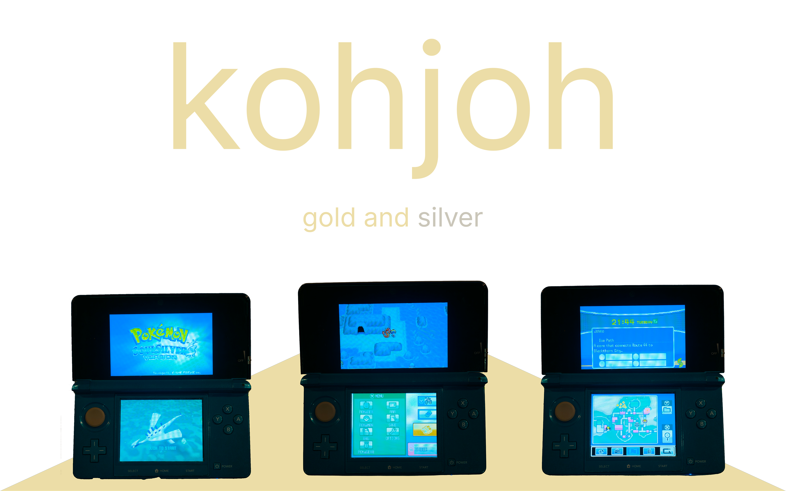

# kohjoh

a native homebrew port of pokemon heartgold and soulsilver for the original 3DS.
this is more of a proof-of-concept than a playable game. expect issues.



uses the WideArt system from [pokeplatinum-3ds](https://github.com/gabesud0/pokeplatinum-3ds) with modifications pulled from [unowncollectables port](https://github.com/unowncollectables/Pokemon-HeartGold-SoulSilver-New3ds)

should run full speed on real hardware. if you find any bugs, file an issue here or complain on discord.

this repository does not contain any unlicensed game data. 
for heartgold, you need a file with sha-1 starting with 4fcded0e2713dc03929845de...
for soulsilver, f8dc38ea20c17541a43b58c5...

- Build: [docs/building-windows.md](docs/building-windows.md)
- How it works: [docs/architecture.md](docs/architecture.md)
- Testing and profiling: [docs/testing.md](docs/testing.md), [docs/lotus.md](docs/lotus.md)
- Lessons and pitfalls: [docs/lessons.md](docs/lessons.md), [docs/troubleshooting.md](docs/troubleshooting.md)
- Design brief: [kohjoh.md](kohjoh.md); imports and licences: [PROVENANCE.md](PROVENANCE.md)
- Complain about this project: [on discord](https://discord.gg/wJNprjYCun)

GPL-3.0 (see [LICENSE](LICENSE)).

The native-resolution text renderer uses **Galmuri14** by Lee Minseo (quiple),
licensed under the SIL Open Font License 1.1. Native glyph adaptations and
supplementary symbols are generated for Kohjoh; see
[`assets/fonts/`](assets/fonts/README.md) and [`PROVENANCE.md`](PROVENANCE.md).
Font assets remain under OFL 1.1, not GPL-3.0.

## Installation

You need a 3DS with custom firmware (Luma3DS), the Homebrew Launcher, and your own unmodified USA dump of the game (`.nds`). Python 3.10+ is needed on your PC for one step.

1. Download from the [latest release](https://github.com/estyseesghosts/kohjoh/releases/latest): `kohjoh-gold.3dsx` (HeartGold) and/or `kohjoh-silver.3dsx` (SoulSilver), and `kohjoh-asset-tools.zip`.
2. Copy the `.3dsx` into the `/3ds/` folder on your SD card, keeping its name: `/3ds/kohjoh-gold.3dsx`.
3. Unzip `kohjoh-asset-tools.zip`. On Windows, drag your `.nds` onto `prepare.bat`. Elsewhere run `python prepare.py your-game.nds`. It checks the dump, then writes a `kohjoh-data/` folder (a few seconds; the ROM is only read, and nothing is uploaded). Add `--sd E:\` (your SD card's drive or mount point) to write straight to `3ds/kohjoh/data/` on the card instead.
4. Copy the contents of `kohjoh-data/` (`heartgold.pak` and `heartgold.manifest.json`, or the `soulsilver` pair) into `/3ds/kohjoh/data/` on the SD card. Create the folders if they don't exist.
5. Launch kohjoh from the Homebrew Launcher.

Never share the `.pak` files: they contain your game's data. Saves are kept on the SD card.

To bring a save from a cart or an emulator, put it at `sdmc:/3ds/kohjoh/saves/heartgold.sav` (or `soulsilver.sav`). A raw 512 KB cart dump works as-is; a DeSmuME `.dsv` or a No$GBA `.SAV` (packed or not) is converted to the raw format the first time the game reads it, and the original is kept beside it as `heartgold.sav.orig`.

The optional CIA is a Luma3DS HOME Menu shortcut; it launches the 3DSX from that exact path and keeps saves on SD. The forwarder requires Luma3DS and has not yet been tested on hardware.

### Overworld rendering resolution

Create `sdmc:/3ds/kohjoh/config.txt` to choose how the field is rendered:

```
# Overworld rendering resolution.
# Valid values: legacy, 1x, 2x
field_scale = 1x
```

| Value | Field presentation | Interface |
| ----- | ------------------ | --------- |
| `legacy` (default) | Existing 400x240 widescreen field | Unchanged |
| `1x` | Wider, zoomed-out field at native 400x240 pixels | Unchanged |
| `2x` | 200x120 field rasterization enlarged 2x to 400x240 (chunky pixels) | Unchanged |

The file is read once at startup. Missing, malformed or unrecognised values safely use `legacy`. The setting does not affect dialogue, menus, battles, the bottom screen, saves or touch input. Details and known limitations: [FIELD_SCALING.md](docs/engineering/hgss-remaster/FIELD_SCALING.md).
